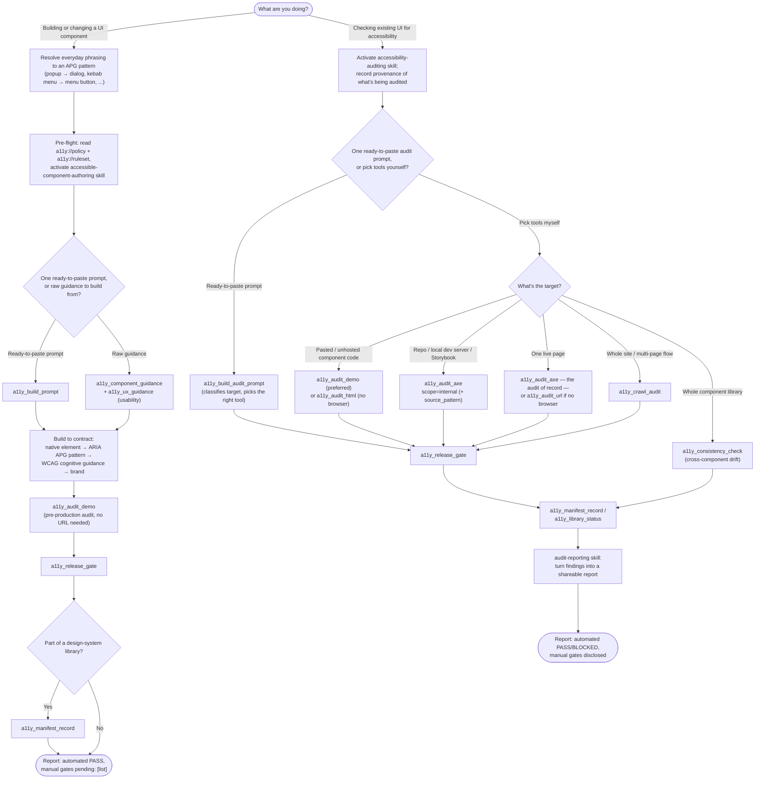

# Choosing the right tool: Create vs. Audit

Malimbe's 21 MCP tools and 7 Skills split into two everyday jobs — **generating**
new or changed UI, and **auditing** UI that already exists — plus a shared layer
that turns either one into a release verdict. This page is a map, not a new
source of truth: for the actual decision hierarchy and rules, see
[`AGENTS.md`](AGENTS.md) (build-side) and
the `accessibility-auditing` skill (MCP resource `a11y://skills/accessibility-auditing`)
(audit-side), or read `a11y://policy` / `a11y://ruleset` directly from a
connected agent. If this page and those ever disagree, they win.

## Decision tree

A clean automated result from either path is **necessary, not sufficient** —
always disclose which manual gates (keyboard walkthrough, screen-reader
output, cognitive review) were not performed. See "Scope and honest limits"
in the [README](README.md#scope-and-honest-limits).

## MCP tools and Skills at a glance

| Name | Type | Role | What it does |
|---|---|---|---|
| `accessible-ui-design` | Skill | Generate | Guides distinctive, coherent web UI and design-system work, including purposeful motion, responsive implementation, browser iteration, and accessibility built in. |
| `ux-best-practices` | Skill | Generate | Source-dated usability guidance (heuristics, forms, navigation, feedback, WCAG 2.2 interaction rules, performance, AI patterns) with a 6-month review cycle and refresh procedure. |
| `accessible-component-authoring` | Skill | Generate | Encodes the native-first → ARIA APG pattern → WCAG cognitive guidance → brand decision hierarchy that governs how components get built. |
| `a11y_component_guidance` | MCP tool | Generate | Returns the accessibility contract — roles, ARIA, keyboard interactions, focus management, pitfalls — for an APG pattern, to build from directly. |
| `a11y_ux_guidance` | MCP tool | Generate | Returns source-cited UX best practices (heuristics, forms, navigation, feedback, WCAG 2.2 interaction, performance, AI, research) picked from a task description, with confidence labels, source status, and a stale-review warning. `mode: "review"` adds review questions. Also readable as `a11y://ux-guidance`. |
| `a11y_build_prompt` | MCP tool | Generate | Assembles a ready-to-paste prompt that primes any coding agent to generate accessible code on the first try, including the mandatory post-generation verify chain. |
| `a11y_build_handoff_spec` | MCP tool | Generate | Produces a standalone Markdown handoff for a ticket, PR, or design review with the component contract, states and variants, design source, and tokens — without agent-only instructions. |
| `accessibility-auditing` | Skill | Audit | Provenance-first audit method: which tool to reach for, what automated checks can't prove, how to report findings honestly. |
| `audit-reporting` | Skill | Audit | Turns raw findings into a human-readable report for developers and project managers; pairs with `accessibility-auditing`. |
| `a11y_audit_html` | MCP tool | Audit | Static WCAG rules check against markup you already have — no browser required. |
| `a11y_audit_demo` | MCP tool | Audit | Serves unhosted component code on an ephemeral localhost and runs a full real-browser axe audit — the pre-production check, no deploy needed. |
| `a11y_audit_axe` | MCP tool | Audit | **The audit of record.** Real-browser axe-core scan (WCAG 2.2 A + AA) plus structure checks, and, for internal targets, source-pattern conformance. |
| `a11y_audit_keyboard` | MCP tool | Audit | Drives real Tab/Shift+Tab key presses through a rendered page: reachability, traps, and focus order vs. visual layout. Pattern-agnostic only -- not a component's specific keyboard contract. |
| `a11y_audit_reading_order` | MCP tool | Audit | Compares DOM order of headings, text, links, and controls against visual position -- the WCAG 1.3.2-groundable proxy for reading order, distinct from focus order. |
| `a11y_audit_announcements` | MCP tool | Audit | Snapshots Chromium's computed accessibility tree (roles, names, states) and flags missing, generic, or repeated control names. Not a real VoiceOver/NVDA/TalkBack speech test -- prepares a targeted manual pass. |
| `a11y_audit_status_messages` | MCP tool | Audit | Watches for content changes with no live region -- autonomous (timers, polling, server push, no click needed) plus an optional explicit trigger_selector. Flags for manual review with the measured reason (viewport, distance), never a pass/fail verdict. |
| `a11y_audit_url` | MCP tool | Audit | Fetches a live URL and audits the delivered HTML. The no-browser fallback when `a11y_audit_axe` can't launch a browser. |
| `a11y_crawl_audit` | MCP tool | Audit | Breadth-first same-origin crawl (up to 20 pages), aggregated into one site-level report with a pass/blocked verdict. Reports the stack once per origin, plus any path whose stack differs. |
| `a11y_detect_stack` | MCP tool | Audit | Reports what a page is built on (CMS, framework, component libraries, overlays, third-party scripts) with evidence and confidence, and where each fix has to happen: native markup, platform template, custom component, or vendor. `a11y_audit_axe` and `a11y_crawl_audit` include the same detection, and the axe audit attributes findings to the widget or platform control that produced them. |
| `a11y_consistency_check` | MCP tool | Audit | Compares every component in the manifest against every other for library-wide drift — prop naming, tokens, duplicate pattern implementations. |
| `a11y_build_audit_prompt` | MCP tool | Audit | Assembles a ready-to-paste audit prompt: classifies the target (repo / internal / external, single-page / crawl) and picks the right audit tool automatically. |
| `accessibility-release-governance` | Skill | Verify & govern | Encodes the seven required gates, three risk tiers, and definition of done that make accessibility a release requirement rather than a suggestion. |
| `malimbeba-dev` | Skill | Verify & govern | Build, test, review-gate loop, and release hygiene for working on Malimbe. The build and test section applies to a source checkout only. |
| `a11y_checklist` | MCP tool | Verify & govern | Engineering-ready per-component checklist, tagged by verification method (auto / auto+manual / manual / design) and which required gate it rolls up to. |
| `a11y_release_gate` | MCP tool | Verify & govern | Evaluates a component against the seven required gates and returns a PASS / BLOCKED verdict, backed by hash-verified browser-audit evidence. |
| `a11y_manifest_record` | MCP tool | Verify & govern | Persists a component's gate verdict, evidence, provenance, and API surface to the library manifest — repo state you commit. |
| `a11y_library_status` | MCP tool | Verify & govern | Rolls the manifest up into a library-level view: pass/blocked counts, tier distribution, missing evidence, exception health. |
| `a11y_browser_check` | MCP tool | Verify & govern | Reports whether browser-backed audits are ready to run, and the one-line fix if not. Run before either path needs a real browser. |

**Generate** produces new or changed UI. **Audit** checks UI that already
exists. **Verify & govern** is the shared layer both paths funnel into —
turning findings (from either side) into a release decision and a durable
record of it.
